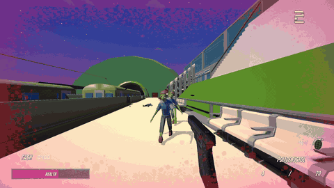
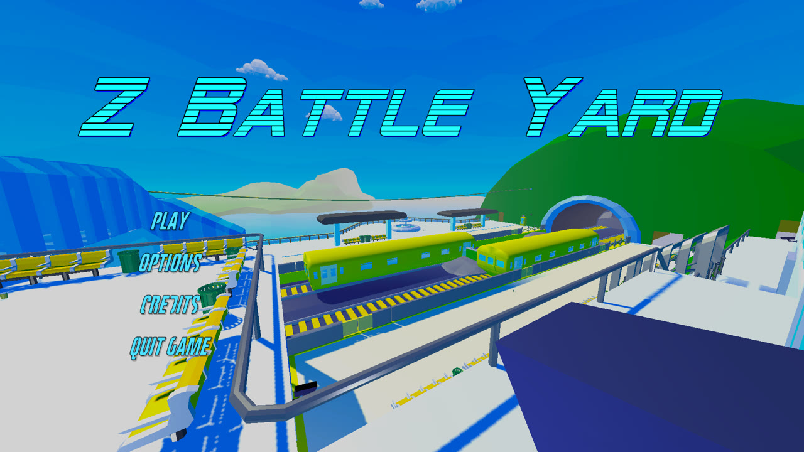
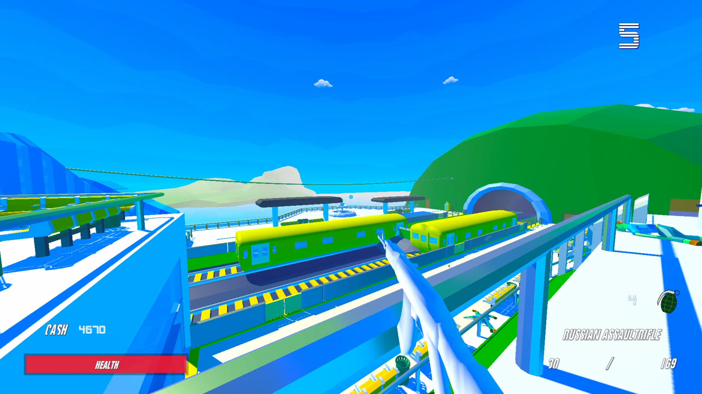
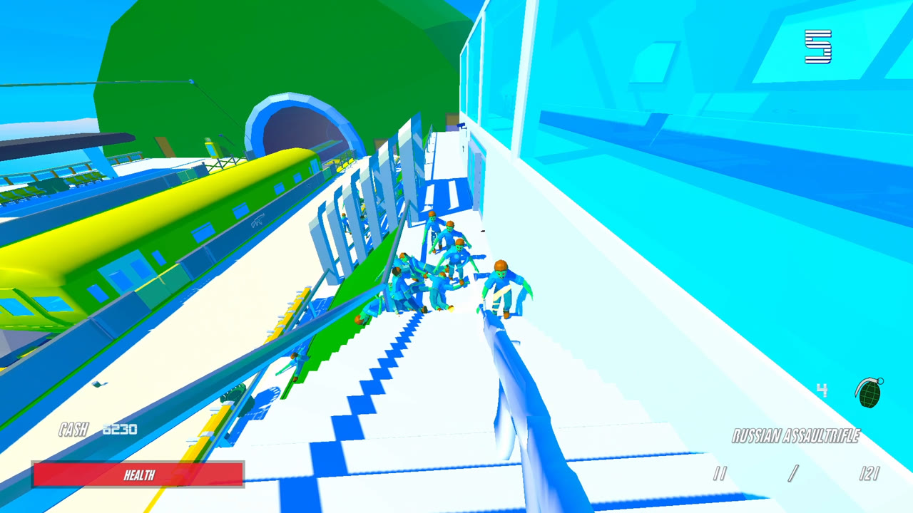
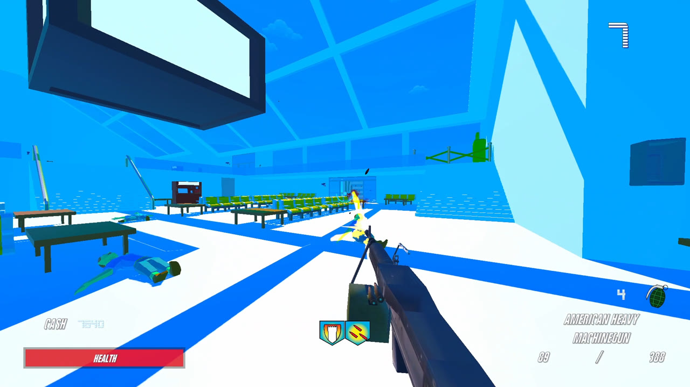
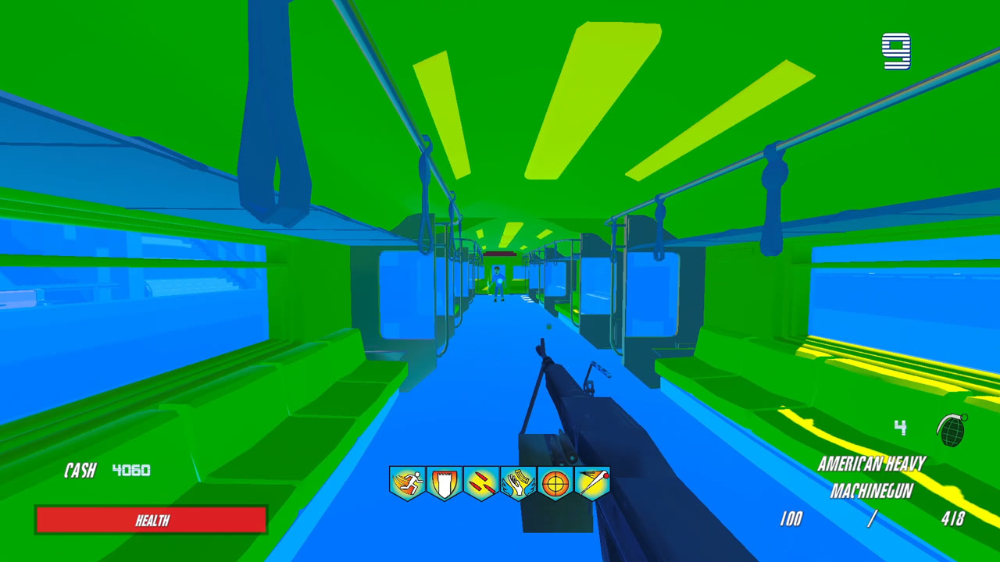
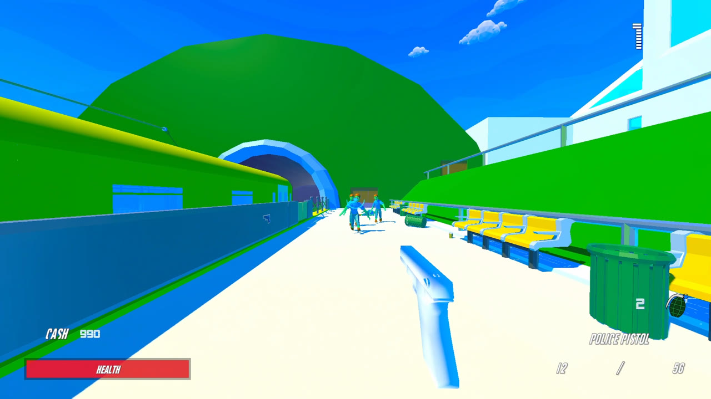

<p align="center">
  
</p>

<p align="center">
  <b>Endless zombie wave shooter in first person, made with Unity 6 (URP) and C#.</b><br>
  Solo project developed during my internship at ESNE Asturias (2022–2023) and shown at CometCon Gijón 2023.
</p>

<p align="center">
  <a href="https://github.com/miguelrg14/Z-Battle-Yard/actions/workflows/ci.yml"></a>
  <a href="https://miguelrg14.github.io/Z-Battle-Yard/"></a>
  <a href="https://miguel-rg14.itch.io/z-battle-yard"></a>
  
</p>

<p align="center">
  <br>
  <sub>Footage from the CometCon 2023 build.</sub>
</p>

## About

Z Battle Yard is inspired by the *Call of Duty: Zombies* game mode. You defend an abandoned train station against endless waves of zombies that get faster and tougher every round. Kills and hits earn points. You spend them on weapons from the walls, perks, the random Mystery Box and new parts of the map.

| Feature | Details |
|---|---|
| Endless waves | The enemy count, health and speed scale every wave; spawn points open as you unlock new rooms |
| Weapons | Pistols, rifles, a baseball bat (melee) and grenades; magazine/reserve ammo, reloads, headshots, weapon sway and recoil |
| Mystery Box | Pay to roll a random weapon with an animated selection |
| Perks | Seven perk machines (Armored Fort, Bullet Legion, Head Blower, Speed Master, Holster Master, Flying Hand, Golden Strike) |
| Power-ups | Random drops: Insta-Kill, Double Points, Max Ammo, Nuke and Mystery Box discount |
| Movement | Walk, sprint with stamina, jump, crouch and prone, flashlight |
| Options | Graphics (quality, resolution, brightness, FOV), audio mixer, mouse sensitivity and key rebinding, saved between sessions |
| Stats | In-game scoreboard (Tab) and end-of-game summary |

## Play

- **In the browser:** [miguelrg14.github.io/Z-Battle-Yard](https://miguelrg14.github.io/Z-Battle-Yard/) (WebGL build deployed by the CI)
- **Windows / Linux:** download the latest build from [Releases](https://github.com/miguelrg14/Z-Battle-Yard/releases) or from [itch.io](https://miguel-rg14.itch.io/z-battle-yard)

### Controls

| Action | Keyboard / mouse |
|---|---|
| Move / look | `W A S D` / mouse |
| Sprint / jump | `Shift` / `Space` |
| Crouch / prone | `Ctrl` / `X` |
| Shoot / reload | Left click / `R` |
| Melee / grenade | `V` / `G` |
| Switch weapon | Mouse wheel or `1` `2` `3` |
| Interact / buy | `E` |
| Flashlight | `T` |
| Scoreboard / pause | `Tab` / `Esc` |

Every key can be rebound in *Options → Controls*. Gamepads are supported.

## Screenshots

| | |
|---|---|
|  |  |
|  |  |
|  |  |

## Run the project

1. Install the Unity 6 version in `ProjectSettings/ProjectVersion.txt` (Unity Hub offers it when you open the project) and [Git LFS](https://git-lfs.com).
2. Clone the repository:
   ```bash
   git lfs install
   git clone https://github.com/miguelrg14/Z-Battle-Yard.git
   ```
3. Open the folder in Unity Hub, then open `Assets/Scenes/MainMenu.unity` and press **Play**.

To build, use *File → Build Profiles* (the scenes are already in the build list: `MainMenu`, `TrainStation`).

## Project structure

```
Assets/
  Scenes/          MainMenu and TrainStation (+ lighting and NavMesh data)
  Scripts/
    Core/          Engine-free game rules (ZBattleYard.Core assembly)
    Enemies/       Wave spawner, zombie AI (NavMesh) and stats
    Player/        Movement, camera, stats, perks, weapons (shooting, melee, grenades, sway)
    PowerUps/      Power-up drops and effects
    Interactables/ Mystery Box and other interactive objects
    UI/            HUD, menus, options, score
    Managers/      Audio managers and global settings
    Input/         Input System actions (GameControls) and rebinding support
  Tests/
    EditMode/      Unit and data-validation tests
    PlayMode/      End-to-end tests that load the real scenes
  Art/ Audio/ Prefabs/ ScriptableObjects/ UI/ Rendering/
  ThirdParty/      Third-party packs (see CREDITS.md)
ArtSource/         Blender, Photoshop, Illustrator and FL Studio source files
ci/                CI helpers (.NET test project, offline compile check)
docs/              Design notes and images
```

## Design notes

- **Data-driven content.** Weapons, perks and power-ups are `ScriptableObject`s, so new items need no code changes.
- **Game rules separated from the engine.** Reload maths, wave scaling, scoring, loot chance and inventory slots live in `ZBattleYard.Core`, an assembly with `noEngineReferences`. They're pure functions that are unit tested in Unity and on plain .NET.
- **Assembly definitions.** `ZBattleYard.Core` → `ZBattleYard.Gameplay` → test assemblies, which keeps compile times short and dependencies explicit.
- **New Input System.** One action asset (`GameControls`) for keyboard/mouse and gamepad. `GameInput` saves rebinds to `PlayerPrefs`, applies them to every live input instance and releases the instances of destroyed objects.
- **Zombie AI.** NavMesh agents chase the player. Their speed and health scale with the wave, and they switch to ragdolls on death.
- **Performance.** I used the Unity Profiler to find UI and spawning spikes. I merged several canvases into one with toggled panels, and added LODs. Lighting was originally baked with Bakery (a paid plugin that isn't included in this repository).
- **Audio.** An Audio Mixer has groups for music, SFX, UI and voice, and the in-game music is a shuffled playlist.

More detail, including the original level sketches, is in [docs/design.md](docs/design.md).

## Tests

| Suite | What it checks | Runs on |
|---|---|---|
| `Tests/EditMode/Core` | Reload and ammo rules, wave difficulty curve, score and loot chance, inventory slots | Unity Test Runner and .NET (`dotnet test ci/CoreTests`) |
| `Tests/EditMode/Gameplay` | Settings defaults, audio conversion, and data validation (build scenes, weapons, perks, power-ups, input actions) | Unity Test Runner |
| `Tests/PlayMode` | Damage and death (each enemy dies once) and healing on a real component; loads the main menu and the game scene, waits for the first wave and checks that a kill awards points and is counted once | Unity Test Runner |

Run them in Unity from *Window → General → Test Runner*. To run the core rules without Unity:

```bash
dotnet test ci/CoreTests
```

## Continuous integration

[`.github/workflows/ci.yml`](.github/workflows/ci.yml) runs on every push:

1. **Core rules tests** on .NET 8.
2. **C# compile check**: compiles every assembly against the Unity 6 engine assemblies and package sources, without a Unity licence.
3. **Unity tests**: EditMode and PlayMode with [GameCI](https://game.ci).
4. **Builds**: Windows, Linux and WebGL. The Linux build is launched headless with `-smoketest`, which skips the menu and starts a game. The job fails if no zombie spawns or any exception is logged.
5. **GitHub Pages**: the WebGL build from `main` is published automatically.
6. **Release**: pushing a `v*` tag attaches the Windows and Linux builds to a GitHub release.

## Credits

Design, programming, 3D art, textures, UI and original music by **Miguel Rodríguez Gallego**. Third-party assets and their authors are listed in [CREDITS.md](CREDITS.md).

## License

The source code is released under the [MIT License](LICENSE). Third-party assets keep their own licences (see [CREDITS.md](CREDITS.md)).
