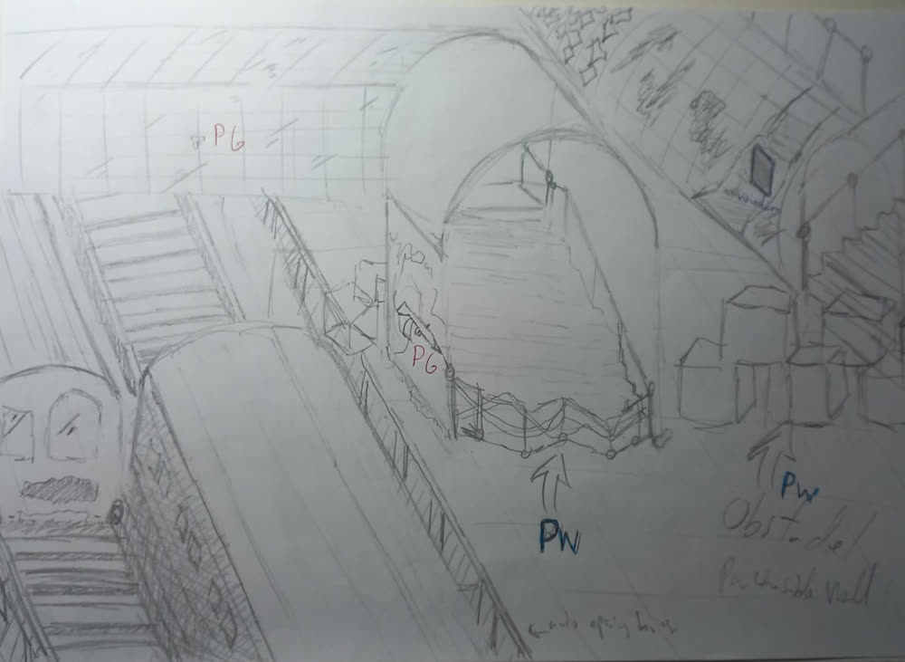
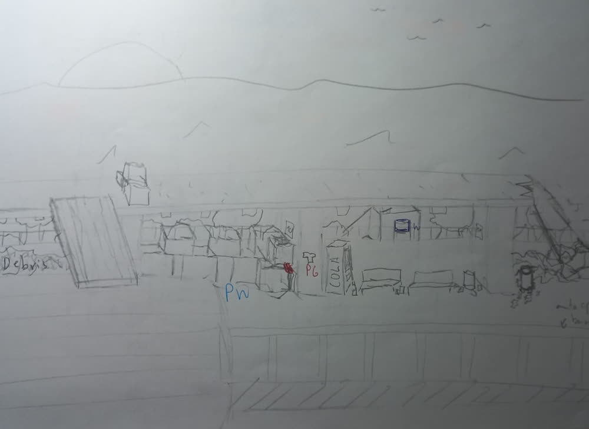
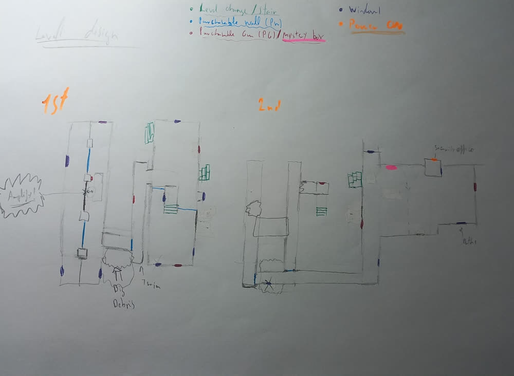

# Z Battle Yard: design notes

English summary of the original game design document (GDD) written for the project.

## Overview

| | |
|---|---|
| Genre | First-person action, wave survival, zombies |
| Platform | PC (Windows), plus a WebGL build |
| Players | 1 |
| Engine | Unity |
| Levels | 1: an abandoned Japanese train station |
| Team | Solo project: design, programming, art, audio |

**Goal.** Reach the highest wave possible. Each wave brings more zombies, and each zombie is tougher and faster. The game only ends when the player dies.

**Premise.** A zombie outbreak has wiped out a train station. The nameless protagonist wakes up as the only survivor and has to hold out against the waves of undead.

## Game loop

1. The player starts at the platform with the starting pistol.
2. Zombies break in through spawn doors that only they can pass through.
3. Kills and hits give points. Headshots and the Double Points power-up give more.
4. Points buy weapons from the walls, rolls of the Mystery Box, perks and barricades. Clearing a barricade opens a new area of the station, along with its zombie spawn points.
5. Between waves the player gets a short break and some grenades back.

## Mechanics

- **Movement:** walk, sprint (limited by stamina), jump, crouch, go prone, flashlight.
- **Combat:** hitscan shooting with headshot multiplier, magazines and reserve ammo, reload, weapon switching, a baseball bat for melee, grenades.
- **Health:** the player regenerates health after a few seconds without taking damage. Zombie health grows linearly with the wave.
- **Perks:** permanent upgrades bought from machines. For example, Armored Fort gives more health, Bullet Legion doubles damage and fire rate, and Head Blower boosts headshot damage. Others speed up reloads, movement or stamina.
- **Power-ups:** random drops from zombies with a short duration: Insta-Kill, Double Points, Max Ammo, Nuke and Mystery Box discount.

## Enemies

Zombies start slow and weak. Their speed (up to a cap) and health grow with every wave. They have a quick, deadly short-range attack and chase the player using the NavMesh. On death they turn into ragdolls.

## Interface

- **Game flow:** main menu → game → pause menu / end-of-game stats → back to the menu or restart.
- **HUD:** wave number, stamina, crosshair, points, health, grenades, equipped weapon and ammo.
- **Options:** graphics (quality, resolution, screen mode, FOV, brightness), controls (sensitivity, key rebinding) and audio (master, music, effects, UI, voice), with a reset to defaults.

## Audio

The main menu theme and the battle theme are original tracks made in FL Studio. In game, the music is a shuffled playlist of royalty-free synthwave tracks (see [CREDITS.md](../CREDITS.md)). The sound effects cover the player (steps, sprint, jump), weapons, purchases, power-ups, waves and zombies.

## Level design sketches

The station layout was planned on paper before it was built in Blender and Unity.

| | | |
|---|---|---|
|  |  |  |

## Tools

Unity, Blender, Mixamo (animations), Substance Painter, Photoshop and Illustrator, FL Studio and Audacity, Bakery (lightmapping, not included in this repository) and itch.io for publishing.
